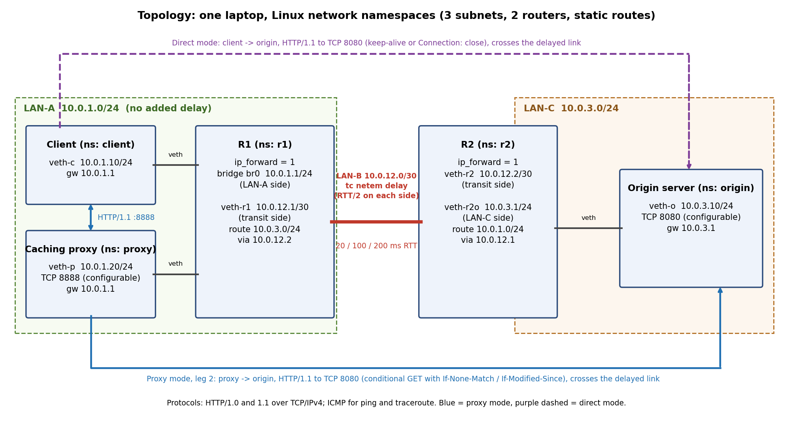

# Introduction

## Problem Statement

According to Kurose and Ross (*Computer Networking: A Top-Down Approach*, Chapter 2), page load time is mainly affected by the number of TCP connections and HTTP requests needed to fetch a page. In this project we build an HTTP server and a caching proxy using plain TCP sockets, to see how much persistent connections and caching improve performance. Both run on a routed network with controlled delay, and the measured results are compared with what the textbook predicts.

Every new TCP connection costs one round trip before any data can be sent, and every request costs at least one more. Over a network with a long round-trip time, the number of connections and requests therefore dominates the load time, which is why persistent connections and caching matter.

## Objectives

1. Implement an HTTP/1.1 server that handles GET, HEAD and POST, returns 200, 301, 304 and 404, uses Content-Length, supports keep-alive and serves clients through a thread pool.
2. Implement a caching proxy that stores responses and revalidates them with conditional GET (If-Modified-Since and ETag).
3. Deploy both on a topology with at least 2 routers and 3 subnets, with delay added using tc netem.
4. Measure page load time, TCP connections per page, requests per second, cache hit ratio and bytes saved by 304 responses.
5. Support the results with packet captures and a README that lets another group repeat the experiments.

## Summary of Findings

- A new TCP connection for every object needed 21 connections, and persistent HTTP needed 1. Persistent HTTP was about 2.0 times faster than non-persistent HTTP at 100 and 200 ms (2.71 s against 5.47 s at 100 ms), close to the textbook ratio of 1.91.
- A warm proxy cache loaded the page in 22 to 35 ms at every RTT, 30 to 206 times faster than direct persistent HTTP, because no packet crossed the delayed link.
- A proxy with an empty cache was within 7.2% (100 ms) and 3.6% (200 ms) of direct persistent HTTP, which is within the run-to-run variation. This needs the proxy to reuse one connection to the origin; without that, the page took 4.77 s instead of 2.90 s at 100 ms.
- A 304 response was 213 bytes instead of 10,506 bytes for a full response. The 37 conditional GETs of the repeat-visit experiment saved 380,841 bytes. Cache hit ratio was 0.800 for five consecutive page loads.
- All measured page-load times were above the textbook model (15% to 30% at 100 and 200 ms), mostly because of delay spikes in the virtual machine, which we measured with ping.

# Network Architecture and Addressing

The whole project runs on one laptop (a VirtualBox virtual machine running Ubuntu) using Linux network namespaces. Five namespaces are used: client, proxy, r1, r2 and origin. Two of them (r1 and r2) act as routers with IP forwarding enabled and static routes only. They connect three subnets. LAN-A (10.0.1.0/24) holds the client and the proxy behind R1. Because LAN-A has three devices (R1, the client and the proxy), it is built with a Linux bridge (br0) inside R1. LAN-B (10.0.12.0/30) is the transit link between R1 and R2. LAN-C (10.0.3.0/24) holds the origin server behind R2.

{width=6.5in}

| Segment | Subnet | Devices |
|---|---|---|
| LAN-A (client side) | 10.0.1.0/24 | R1 (br0) 10.0.1.1, Client (veth-c) 10.0.1.10, Proxy (veth-p) 10.0.1.20 |
| LAN-B (transit) | 10.0.12.0/30 | R1 (veth-r1) 10.0.12.1, R2 (veth-r2) 10.0.12.2 |
| LAN-C (server side) | 10.0.3.0/24 | R2 (veth-r2o) 10.0.3.1, Origin (veth-o) 10.0.3.10 |

Table: Addressing plan (all subnets come from 10.0.0.0/16).

The origin server listens on TCP port 8080 and the proxy on TCP port 8888 (both configurable). The client and the proxy use 10.0.1.1 as their default gateway and the origin uses 10.0.3.1. R1 has a static route to 10.0.3.0/24 via 10.0.12.2, and R2 has a static route to 10.0.1.0/24 via 10.0.12.1.

## Routing Evidence

Routing table of R1:

@@FILE:docs/evidence/r1_routes.txt@@

Routing table of R2:

@@FILE:docs/evidence/r2_routes.txt@@

Traceroute from the client to the origin:

@@FILE:docs/evidence/traceroute_client_to_origin.txt@@

Hop 1 is R1 (10.0.1.1), hop 2 is R2 (10.0.12.2) and hop 3 is the origin (10.0.3.10), so every packet between the client side and the server side crosses both routers.

## Delay

Delay is added with tc netem on the transit link. Because netem delays packets in one direction only, half of each RTT is applied on each side (for example 50 ms on both the R1 and the R2 interface for a 100 ms RTT). The resulting RTT was verified with ping from the client to the origin (20 pings per setting, in the virtual machine that produced the results):

| Nominal RTT (ms) | min (ms) | avg (ms) | max (ms) |
|---|---|---|---|
| 20 | 20.985 | 44.323 | 298.561 |
| 100 | 100.860 | 112.535 | 154.264 |
| 200 | 201.692 | 250.959 | 465.750 |

Table: Round-trip time measured with ping for each netem setting.

The minimum RTT is within 1.0, 0.9 and 1.7 ms of the nominal value, so the delay is applied as intended. The average and the maximum are higher because the virtual machine adds occasional large delays (see the comparison with the textbook model). The path from the client to the proxy stays inside LAN-A and has no added delay:

@@FILE:docs/evidence/ping_client_proxy.txt@@

## Direct Mode and Proxy Mode

In direct mode the client talks to the origin server across the delayed link. In proxy mode the client talks to the proxy inside LAN-A (no added delay) and only the proxy-to-origin leg crosses the delayed link.

# Protocols and Technologies

The main protocols are HTTP/1.0 and HTTP/1.1, TCP and IPv4, with ICMP used for ping and traceroute. HTTP features used: the methods GET, HEAD and POST; the status codes 200, 301, 304, 404 (and 400, 405 and 500 for errors); the headers Content-Length, Content-Type, Connection, Keep-Alive, ETag, Last-Modified, If-None-Match, If-Modified-Since, Cache-Control, Expires, Location and Date; and the custom headers X-Cache and Age added by the proxy for observation.

| Tool | Purpose | Version |
|---|---|---|
| Python 3 (socket, threading) | Server, proxy and client | 3.14.4 |
| Linux network namespaces (iproute2) | Routers, subnets, static routes | iproute2 6.19.0 |
| tc netem | Delay on the transit link | iproute2 6.19.0 (kernel module sch_netem) |
| Wireshark and dumpcap | Packet captures and analysis | 4.6.4 |
| tcpdump | Counting SYN packets | 4.99.6 |
| curl | Manual tests, sizes of 200 and 304 | 8.18.0 |
| ApacheBench (ab) | Requests per second | 2.3 |
| traceroute, ping, ss | Path evidence, RTT check, connection counts | traceroute 2.1.6; ping from iputils; ss from iproute2 6.19.0 |
| matplotlib | Figures | 3.10.7 |

Table: Tools and versions.

The experiments ran in a VirtualBox 7.2.8 virtual machine with 2 CPUs and 3.2 GiB RAM running Ubuntu 26.04 LTS.

# Origin Server Design and Implementation

The origin server (`server/server.py`) is written with plain TCP sockets and the `threading` module only.

**Thread pool.** The main thread accepts connections and puts them in a queue. A fixed pool of 64 worker threads (configurable with `--threads`) takes connections from the queue and serves them. A worker serves all requests of one connection before taking the next one, so one persistent connection occupies one worker.

**Request parsing.** The server reads the request line and the headers line by line, limits the number of headers, and reads the body using Content-Length. Malformed requests get a 400 response.

**Responses.** Every response has a Content-Length. A 200 response also carries Content-Type, Last-Modified and an ETag. The ETag is built from the file's modification time and size, so it changes whenever the file changes. HEAD returns the same headers without a body. POST to any path returns 200 with the text "Received N bytes". Other methods get 405 with an Allow header. `/old.html` returns 301 with `Location: /index.html`. A missing file returns 404. Paths are resolved with `realpath` and must stay inside the web root, so `../` tricks return 404.

**Persistent connections.** HTTP/1.1 requests are persistent by default and `Connection: close` ends the connection. HTTP/1.0 requests are persistent only when the client sends `Connection: keep-alive` (as `ab -k` does). The server closes idle connections after 5 seconds (`--timeout`). `--no-keepalive` forces `Connection: close` on every response, which is used for the non-persistent experiments.

**Conditional requests.** If the request has If-None-Match and the ETag matches (or the value is `*`), the server answers 304 with no body. If-None-Match takes priority over If-Modified-Since, as in the HTTP specification. Otherwise If-Modified-Since is compared with the file's modification time.

**Logging.** Each request is logged with timestamp, client address, method, path, status and body bytes (`--quiet` turns this off during throughput tests).

**Testing.** The server was tested with curl for 200, 301, 304 (with ETag and with If-Modified-Since), 404, 405, HEAD and POST, and for connection reuse (one connection for several requests, two when `Connection: close` is sent or `--no-keepalive` is used). The script `experiments/smoke_test.sh` repeats these checks automatically on the full topology: it builds the network, starts the server and the proxy and runs 20 checks, and it passed with 20 of 20 checks on a fresh clone of the repository.

# Experimental Methodology

## Test Page and Client

The origin serves one test page (`index.html`) that references 20 objects (`obj01.dat` to `obj20.dat`), each exactly 10,240 bytes. A page load is therefore 1 base page plus 20 objects, or 21 requests. The client (`client/client.py`) is also written with plain sockets. It loads the base page, extracts the 20 object references, and fetches them **one at a time** so that the results can be compared directly with the textbook model. It measures the page load time from just before the first request to the last byte of the last object, and counts the TCP connections it opens.

## The Four Cases

1. **Non-persistent:** a new TCP connection and `Connection: close` for every object.
2. **Persistent:** one TCP connection reused for all 21 requests (HTTP/1.1 keep-alive).
3. **Through the proxy, empty cache:** the proxy's cache is emptied (not timed) before every run.
4. **Through the proxy, warm cache:** the cache is filled by one earlier, unrecorded run.

Each case was run at RTT values of 20 ms, 100 ms and 200 ms on the transit link, 5 runs per combination (the proposal required at least 3). The mean and standard deviation are reported. Repeat visits after changing 5 objects show conditional GET at work. All page-load, cache and ApacheBench experiments were run in the same virtual machine. An earlier run of the direct page-load matrix on a second machine is kept in `experiments/results/direct_full_iqra_machine.csv`.

## Metrics

| Metric | How it was measured |
|---|---|
| Page load time | Client timer (first request to last object), compared with the textbook RTT model |
| TCP connections per page | Counter in the client; distinct client ports seen by `ss`; SYN packets in tcpdump captures |
| Requests per second | ApacheBench, 3000 requests, concurrency 1, 10 and 50, with and without `-k`, 3 runs each, RTT set to 0 |
| Cache hit ratio | Proxy log: (HIT + REVALIDATE_304) / GET requests |
| Bytes saved by 304 | Size of a full 200 (headers + body) minus the size of a 304, measured with curl, times the number of 304 responses |

Table: Metrics and measurement methods.

ApacheBench uses HTTP/1.0 without keep-alive by default, so the `-k` option was used for the keep-alive tests. Throughput tests ran with the delay removed (RTT 0), so they measure the speed of the server and the proxy and not the delay. For each case the median and the range of the 3 runs are reported, because the runs varied a lot in the virtual machine.

## Differences from the Proposal

- Every page-load case has 5 runs, not just the minimum of 3.
- Throughput was measured at RTT 0 (no delay) so that it shows the speed of the programs and not of the network.
- The proxy keeps a pool of persistent connections to the origin. This was not in the proposal; it is needed because, without it, every cache miss would pay a new TCP handshake, and the proxy would look about 1.6 times slower than direct persistent HTTP.
- The proxy TTL was 3600 s for the page-load matrix (so entries stay fresh) and 5 s for the repeat-visit experiment (so entries become stale quickly).
- The optional extras of the proposal (packet loss, bandwidth limits, parallel connections) were not done.

## Threats to Validity

All measurements ran on one laptop inside a virtual machine. Ping showed occasional delay spikes of 154 to 466 ms (maxima) on top of the netem delay, so run-to-run variation is large, mostly at 20 ms. We therefore report standard deviations and, where the variation matters, medians and ranges. The ping sample was taken at a different time from the page-load runs, so it supports a qualitative explanation and is not a precise correction.
