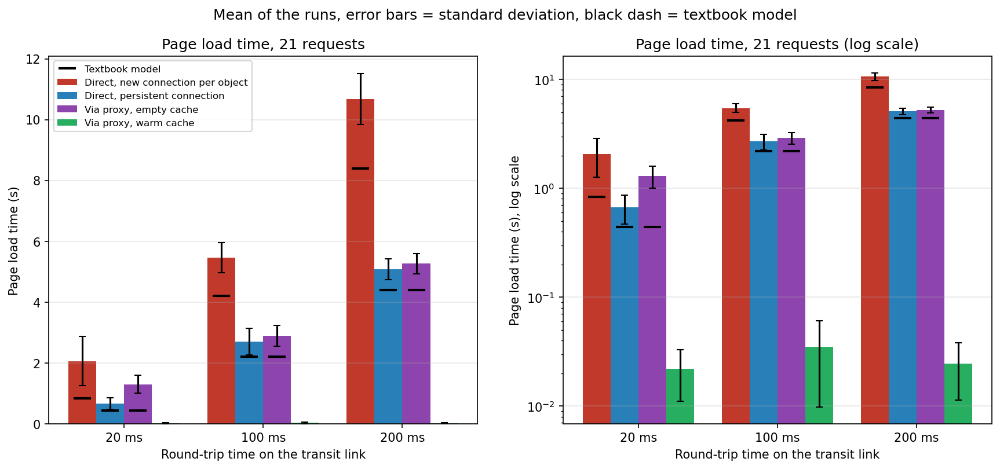
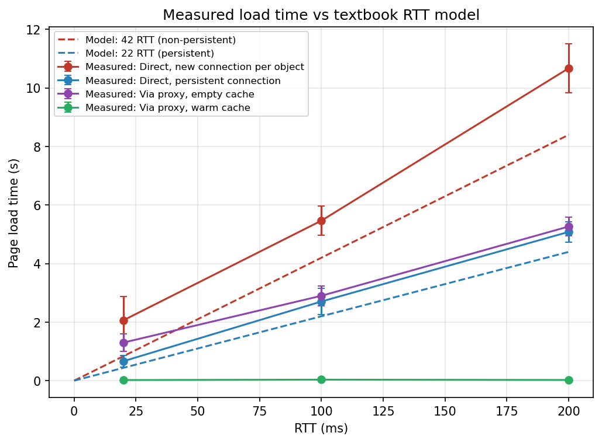
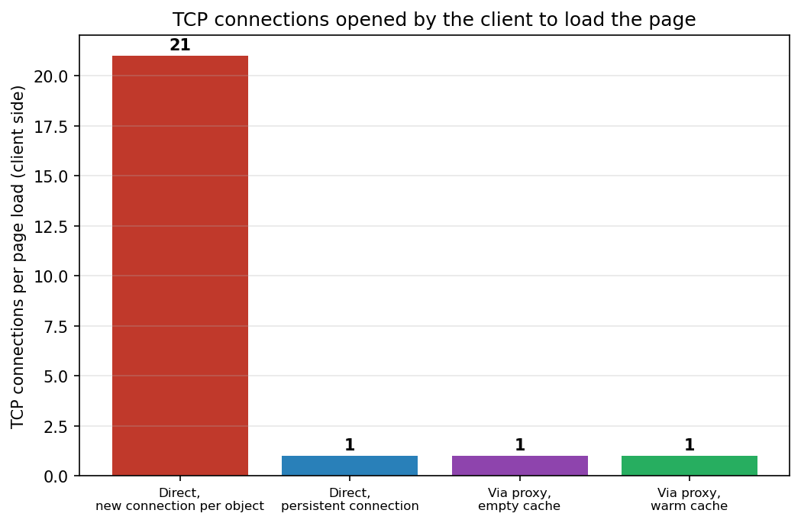
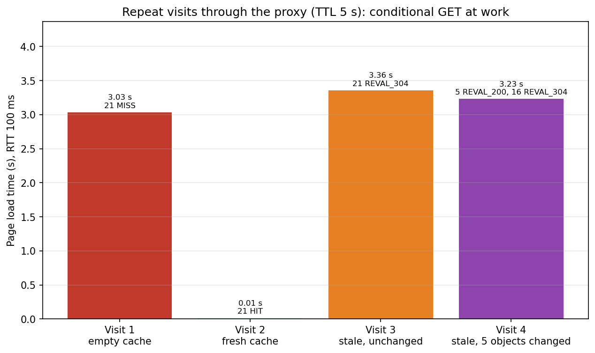
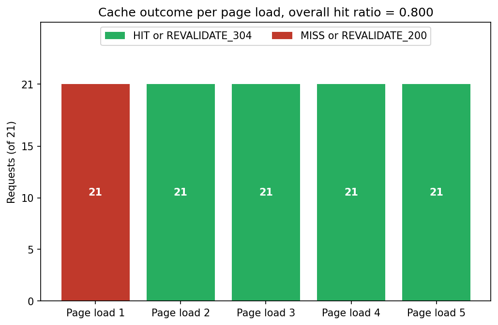
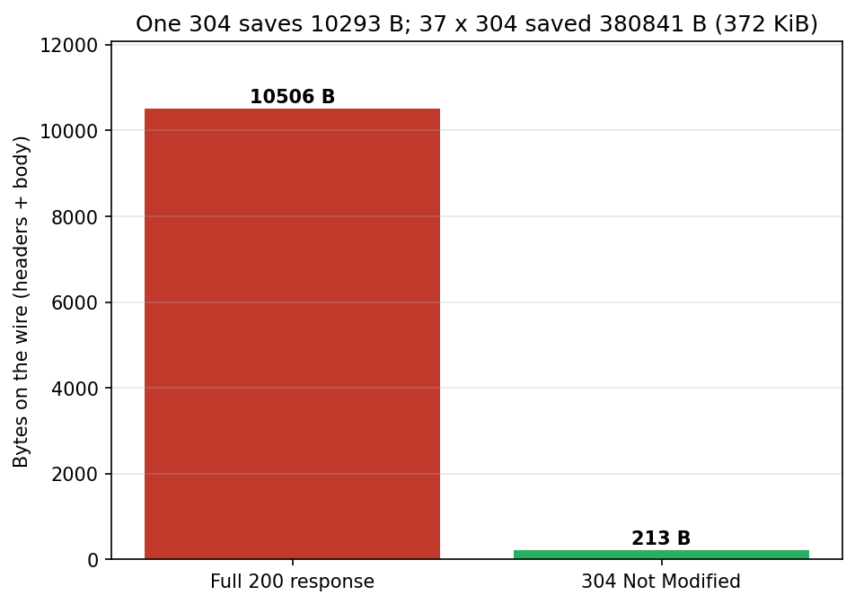
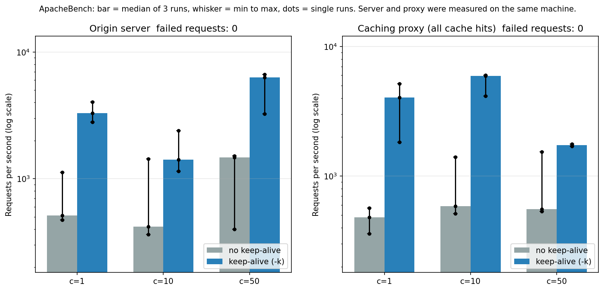

# Caching Proxy Design and Implementation

The caching proxy (`proxy/proxy.py`) is written with plain sockets and the `threading` module. It accepts connections from clients, creates one thread per client connection, and answers GET requests from an in-memory cache when possible.

**Cache structure.** The cache is a dictionary keyed by the full absolute URL (for example `http://10.0.3.10:8080/obj01.dat`) and protected by a lock. Each entry stores the status line, the headers, the body, the time it was stored, the ETag and the Last-Modified value. Only responses with status 200 are stored. A response with `Cache-Control: no-store` or `private` is never stored, and `no-cache` entries are stored but revalidated every time.

**Freshness.** An entry is fresh while its age is below its lifetime. The lifetime is the `Cache-Control: max-age` value if the origin sent one, else the time until the `Expires` date, else the configurable default TTL (`--ttl`, 30 s by default). A fresh entry is served directly (log result HIT) with an `Age` header, and the origin is not contacted at all.

**Revalidation with conditional GET.** When an entry is stale, the proxy sends a conditional GET to the origin with `If-None-Match` (the stored ETag) and `If-Modified-Since` (the stored Last-Modified). If the origin answers 304, the entry's timer is reset and the cached body is served (REVALIDATE_304). If it answers 200, the entry is replaced (REVALIDATE_200). The client's own conditional and range headers are dropped, so the client always gets a complete 200 response from the proxy.

**Requests that are never cached.** POST, HEAD and every other method are forwarded to the origin and never cached (log result BYPASS). A non-200 answer to a revalidation (for example 404) removes the old entry.

**Persistent connections.** The proxy keeps client connections open between requests (idle timeout 15 s, `--idle`), and it keeps a pool of idle persistent connections to the origin. Without that pool, every cache miss would need a new TCP connection to the origin, which costs 2 RTT instead of 1 RTT per object. Pooled connections idle for more than 3 s are dropped because the origin closes idle connections after 5 s. A failed GET or HEAD on a reused connection is retried once on a new connection, but POST is never retried. `--no-upstream-keepalive` turns the pool off, which was used to measure its effect.

**Observation features.** Every response carries `X-Cache: HIT | MISS | REVALIDATE_304 | REVALIDATE_200 | BYPASS`. Every request is written to a log file with timestamp, method, URL, result, status and bytes sent to the client. The endpoint `/__clear` empties the cache, the pool, the counters and the log between experiment runs, and `/__stats` prints the number of new and reused origin connections.

**Limits.** Chunked responses, pipelining, range requests and HTTPS are not supported.

**Testing.** The proxy was tested with curl for MISS followed by HIT, for a stale entry (REVALIDATE_304), for a changed file (REVALIDATE_200), for 404 and POST pass-through (never cached), and with the counters of `/__stats`: five different objects used 1 new and 4 reused origin connections with the pool, and 5 new connections with `--no-upstream-keepalive`. The smoke test repeats the main checks on the full topology.

# Results

All results in this section were measured in the same virtual machine, at the RTT values 20, 100 and 200 ms, with 5 runs per page-load case.

## Page Load Time

@@TABLE:load_time@@

{width=6.5in}

{width=5in}

@@TABLE:derived@@

Both modes scale linearly with the RTT, and non-persistent HTTP is always slower. The ratio of non-persistent to persistent is 3.10 at 20 ms, 2.02 at 100 ms and 2.10 at 200 ms (model: 1.91), and persistence saved 1.40 s, 2.76 s and 5.59 s. Every measured mean is above the model: by 27% to 146% for non-persistent and 16% to 52% for persistent HTTP. The excess is largest and noisiest at 20 ms, where the standard deviation is 39% (non-persistent) and 29% (persistent) of the mean, against 6.8% to 16.4% at 100 and 200 ms. The fastest run of each case, which is the one least disturbed by the virtual machine, is 8.6% to 22.0% above the model, so the model is a good lower bound. At 100 and 200 ms the variation between runs is large compared with the differences between cases, so the trend (a factor of about 2, linear in the RTT) is reliable, but the exact percentages are not.

## TCP Connections per Page

@@TABLE:connections@@

{width=4.5in}

The client opened 21 connections in non-persistent mode and 1 in the other modes, in every run and at every RTT. This was confirmed by counting SYN packets in the captures (21 and 1) and by sampling `ss` (1 client port for the persistent load; 20 for the non-persistent load, because one very short connection fell between two 50 ms samples, so the SYN count is the authoritative one). This matches the textbook model exactly. Through the proxy the client still uses 1 connection, because the proxy supports persistent connections.

## Effect of the Proxy

| RTT (ms) | Direct persistent (s) | Proxy, empty cache (s) | Difference | Proxy, warm cache (s) | Warm speed-up |
|---|---|---|---|---|---|
| 20 | 0.666 ± 0.195 | 1.302 ± 0.297 | +95.4% | 0.022 ± 0.011 | 30x |
| 100 | 2.705 ± 0.444 | 2.900 ± 0.341 | +7.2% | 0.035 ± 0.025 | 77x |
| 200 | 5.083 ± 0.348 | 5.267 ± 0.326 | +3.6% | 0.025 ± 0.013 | 206x |

Table: Direct persistent HTTP compared with the proxy.

With an empty cache the proxy keeps one persistent connection to the origin, so the page costs the same 22 RTT as direct persistent HTTP. At 100 and 200 ms the proxy is only 7.2% and 3.6% slower, and the difference (0.195 s and 0.184 s) is smaller than the run-to-run standard deviation (0.33 to 0.44 s), so it is not significant. At 20 ms the proxy is 95% slower; that is the noisiest setting, and the data we have cannot explain it. With a warm cache the page loads in 22 to 35 ms at every RTT, because no packet crosses the delayed link and the client only talks to the proxy on LAN-A. That is 30 to 206 times faster than direct persistent HTTP.

Without the proxy's connection pool (`--no-upstream-keepalive`, 3 runs at 100 ms) every cache miss opened a new connection to the origin (21 new connections, none reused) and the page took 4.765 s (standard deviation 0.063 s). That is 13.5% above the 42 RTT model value, and 1.865 s (39%) slower than the same page with the pool (2.900 s).

## Repeat Visits and Conditional GET

@@TABLE:revisit@@

{width=5.5in}

Visit 1 fills the cache (21 MISS). Visit 2 within the TTL is answered by the cache (21 HIT) in 0.011 s. Visit 3 comes after the TTL: each of the 21 entries is revalidated with a conditional GET and the origin answers 304, so the page takes 3.360 s, about as long as a cache miss (3.035 s). Each conditional GET still crosses the delayed link and costs 1 RTT, so a 304 saves bytes and not time. Visit 4, after changing 5 objects, gives 5 REVALIDATE_200 and 16 REVALIDATE_304. The three slow visits differ by less than the standard deviation of the empty-cache case at 100 ms, and each was run once, so their differences are not significant.

## Cache Hit Ratio

@@TABLE:hitratio@@

{width=4.5in}

The hit ratio is (HIT + REVALIDATE_304) divided by all GET requests. In five consecutive page loads with a long TTL the first load is all misses and the next four are all hits, giving 84 / 105 = 0.800. In the repeat-visit experiment the ratio is (21 + 37) / 84 = 0.690.

## Bytes Saved by 304 Responses

@@TABLE:bytes@@

{width=4.2in}

A 304 response has headers only and no body: 213 bytes, compared with 10,506 bytes (266 bytes of headers and 10,240 bytes of body) for a full 200 response. One 304 therefore saves 10,293 bytes (98% of the response), and the 37 REVALIDATE_304 responses of the repeat-visit experiment saved 380,841 bytes (about 372 KiB).

## Throughput

@@TABLE:ab@@

{width=6.5in}

Both the origin server and the proxy were benchmarked in the same machine at RTT 0, with 3000 requests per run and 3 runs per case, for the same 10 KB object (the proxy answered only cache hits). Medians and ranges are reported because runs of the same case varied by up to about 4 times, mostly without keep-alive. Keep-alive raised throughput by a factor of 3.1 to 10.1 in every case, because no new TCP connection is needed for each request. No error responses were recorded in any run, so all requests were normal 200 responses. The proxy was faster than the origin with keep-alive at concurrency 1 (1.2 times) and 10 (4.2 times) and slower at concurrency 50 (the origin was 3.6 times faster); the ordering is not consistent and the runs vary a lot, so this comparison is inconclusive. Throughput does not grow steadily with concurrency, which is expected when many Python threads share one interpreter lock on a virtual machine with few CPUs. Concurrency was kept at or below the 64 worker threads of the origin, because a persistent connection occupies one worker while it is open.

# Comparison with the Textbook Model

The textbook model counts round trips. Fetching one object over a new connection costs 1 RTT for the TCP handshake plus 1 RTT for the request and response, so 2 RTT per object. The test page has 21 requests fetched one at a time, giving 42 RTT for non-persistent HTTP. With one persistent connection and no pipelining, the handshake is paid once, so the total is 1 + 21 = 22 RTT. At 200, 100 and 20 ms this predicts 8.4 s against 4.4 s, 4.2 s against 2.2 s and 0.84 s against 0.44 s. Transmission and processing time are ignored by the model.

The measurements show the same structure (a factor of about 2 between the modes, linear growth with the RTT, 21 against 1 connections) but with larger absolute times: the means are 15% to 30% above the model at 100 and 200 ms, and much more at 20 ms. The ping measurements explain the direction of the difference (20 pings per setting):

| Nominal RTT (ms) | Average ping (ms) | 42 x average (s) | Measured non-persistent (s) | 22 x average (s) | Measured persistent (s) |
|---|---|---|---|---|---|
| 20 | 44.3 | 1.862 | 2.066 | 0.975 | 0.666 |
| 100 | 112.5 | 4.726 | 5.467 | 2.476 | 2.705 |
| 200 | 251.0 | 10.540 | 10.674 | 5.521 | 5.083 |

Table: Model predictions using the average RTT measured with ping instead of the nominal RTT.

The minimum ping is within 2 ms of the nominal value, so netem works as intended, but the average is 12.5 to 51 ms higher and the maxima reach 154 to 466 ms. The extra time therefore comes from occasional large delays in the virtual machine and not from a fixed cost per round trip. Python processing cannot explain it: a page from a warm proxy cache takes only 22 to 35 ms for all 21 requests, about 1 to 2 ms per request, while the measured excess over the model is 11 to 108 ms per request. With the measured average RTT in place of the nominal one, the model is within 16% of the measurement at 100 and 200 ms; at 20 ms the average ping is dominated by a few spikes, so that comparison is not reliable.

The model does not apply directly in two places. A warm cache removes every round trip over the delayed link, so the load time no longer depends on the RTT. A conditional GET still costs 1 RTT, so its benefit is bytes and not time.
