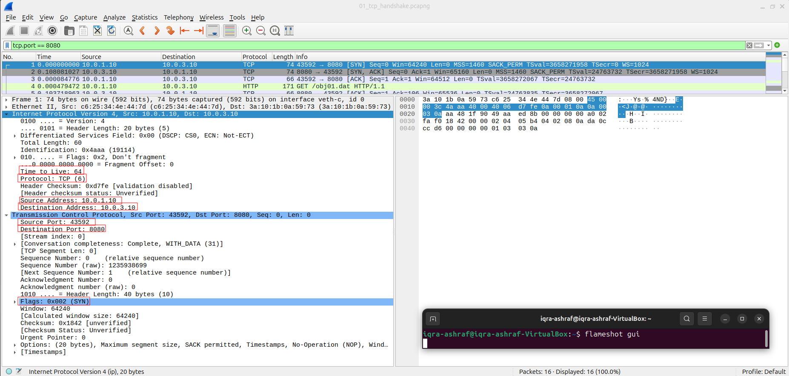
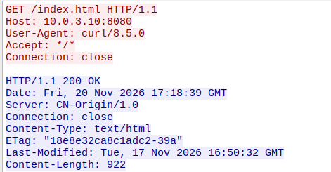
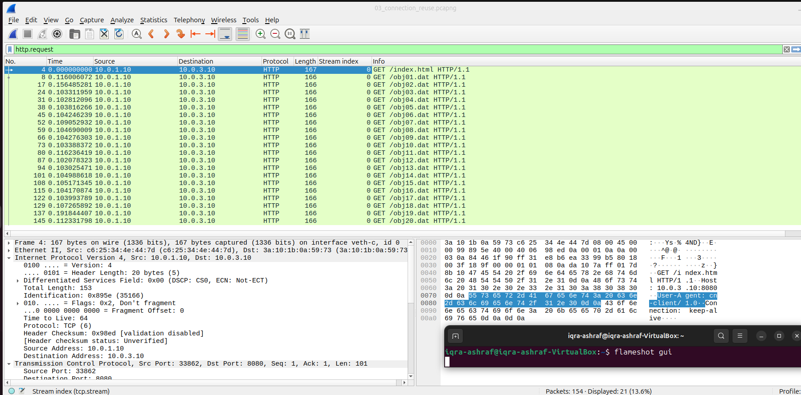
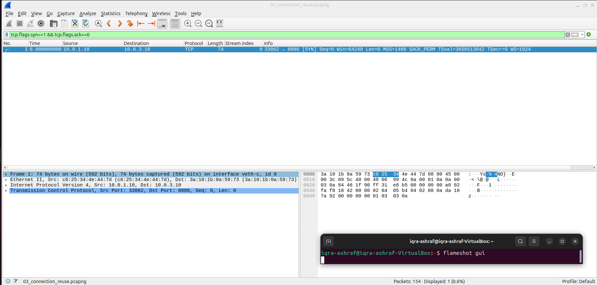
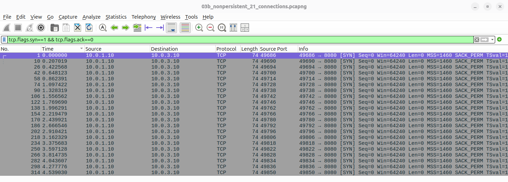
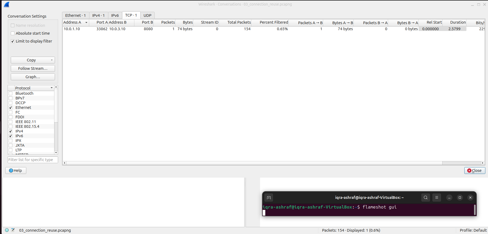

# Packet Capture Analysis

Captures were taken with dumpcap inside the network namespaces and opened in Wireshark. The screenshots are annotated with addresses, ports, flags and header fields. All capture files are in the `captures/` folder of the repository (see `docs/evidence/INDEX.md`). Direct-mode captures were taken on the client interface at an RTT of 100 ms.

## TCP Handshake

{width=6in}

The client (10.0.1.10, an ephemeral source port) opens the connection to the origin (10.0.3.10, port 8080) with a SYN. The origin answers with SYN-ACK, and the client completes the handshake with an ACK. The SYN-ACK arrives 108 ms after the SYN, which is about one round trip at this setting (100 ms of netem delay). The handshake therefore costs 1 RTT before any HTTP data can be sent, which is the "+1 RTT per object" that the textbook model charges to non-persistent HTTP.

## GET Request with a 200 Response

{width=6in}

The request line is `GET /index.html HTTP/1.1` with a Host header and `Connection: close`. The origin answers `200 OK` with Content-Length, Content-Type, Last-Modified and an ETag. The ETag and the Last-Modified value are what the proxy later stores and sends back as `If-None-Match` and `If-Modified-Since` when it revalidates an entry.

## Connection Reuse

{width=6in}

{width=6in}

{width=6in}

{width=6in}

In the persistent page load all 21 requests share one TCP stream, and the capture contains exactly one SYN. The non-persistent page load sends 21 SYN packets, one per object. These counts match the connection counts of the client and the samples of `ss`. A persistent connection saves 20 handshakes, which is 20 RTT, and this agrees with the measured difference between the two modes: persistence saved 2.76 s at 100 ms, and 20 RTT at 100 ms would be 2.0 s, with the rest being the extra time that each new connection costs in the virtual machine.
