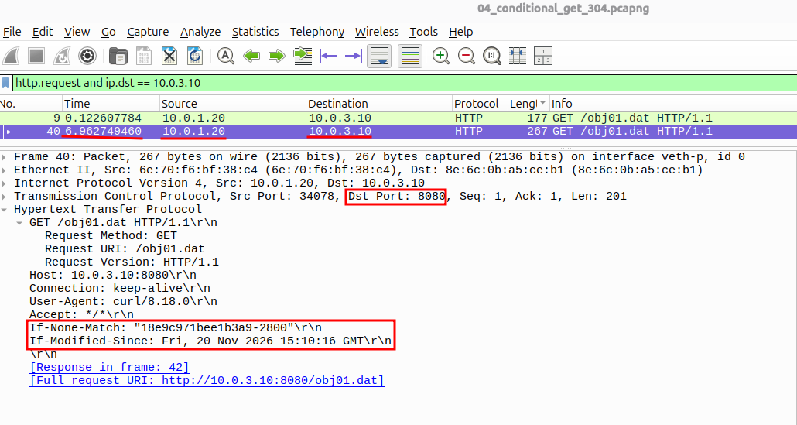
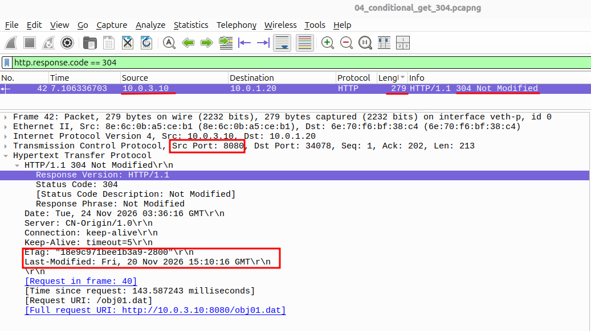
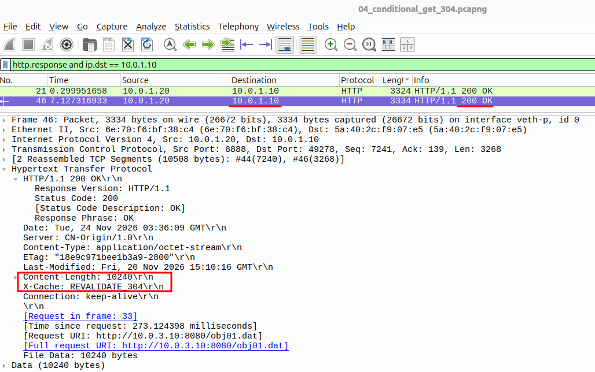
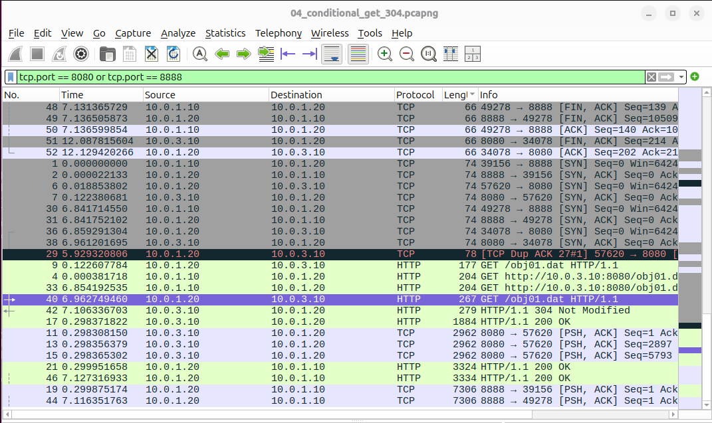
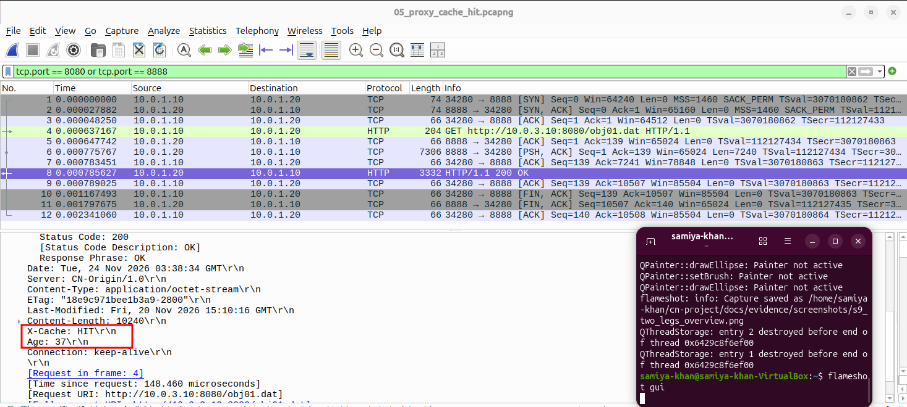
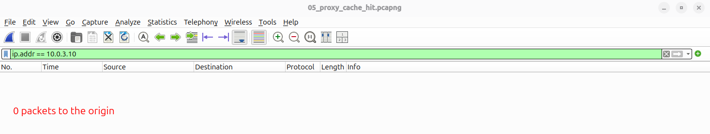

## Conditional GET and the 304 Response

Proxy-mode captures were taken on the proxy's interface, so they show both the client-to-proxy leg (port 8888) and the proxy-to-origin leg (port 8080).

{width=6in}

{width=6in}

{width=6in}

{width=6in}

The first request made the proxy fetch the object from the origin (MISS) and store it with its ETag and Last-Modified value. After the 5 s TTL had expired, the second client request made the proxy send a second request to the origin that carries `If-None-Match` with the stored ETag and `If-Modified-Since` with the stored date (both visible in the first screenshot). The origin answered `304 Not Modified` with headers only and no body (213 bytes, against 10,506 bytes for a full response). The proxy then sent the client a complete `200 OK` with `X-Cache: REVALIDATE_304`, so the client never sees the difference. The overview screenshot shows that the second proxy-to-origin connection began with a new TCP handshake, because the pooled connection had been idle for more than 3 s and was dropped.

## Proxy Cache Hit

{width=6in}

{width=6in}

The request was answered from the cache with `X-Cache: HIT` and an `Age` header. All packets in the capture are between 10.0.1.10 (client) and 10.0.1.20 (proxy) on port 8888, and a filter on the origin address 10.0.3.10 shows 0 packets. A cache hit therefore never reaches the origin and never crosses the delayed link, which is why the warm-cache load time does not depend on the RTT.
